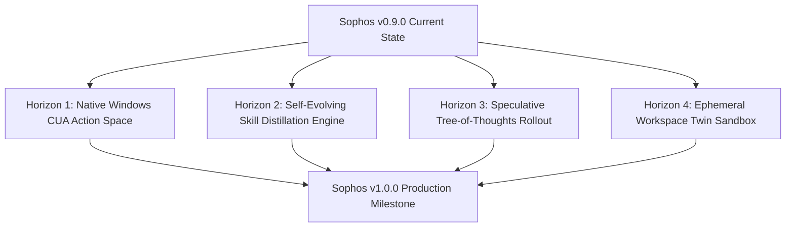

# Sophos Next-Generation Architecture Roadmap (v1.0.0 & Beyond)

> **For Hermes & Gauntlet-RLM Squads:** Use this plan to guide future iterative milestone upgrades for the Sophos Harness.

**Goal:** Transform Sophos into the ultimate Windows-native autonomous development environment, pairing deep AI reasoning with native OS action, self-distilling skills, and speculative verification.

---

## Strategic Horizons Overview

---

## 1. Horizon 1: Native Windows CUA & Action Space (Anthropic Computer-Use + Windows UIA)

### Objective
Provide agents with native Windows GUI automation (clicking buttons, reading accessibility trees, inspecting window hierarchy) completely headlessly in the background.

### Key Components
1. **Rust UIA COM Bridge (`src-tauri/src/native/uia.rs`)**:
   - Query UI Automation tree for open applications.
   - Dispatch programmatic clicks and keystrokes without stealing mouse focus.
2. **IPC Seam (`src/ipc/contract.ts`)**:
   - `captureWindowScreenshot(windowTitle: string): Promise<string>`
   - `inspectAccessibilityTree(windowTitle: string): Promise<AxNode[]>`
   - `dispatchUiAction(action: UiAction): Promise<ActionResult>`
3. **Frontend UI Panel (`src/features/cua/CuaControlPanel.tsx`)**:
   - Live visual snapshot of background test apps with bounding box overlays.

---

## 2. Horizon 2: Self-Evolving Skill Distillation & Experience Engine (Voyager & Eureka)

### Objective
Automatically extract reusable patterns, tool chains, and debugging solutions from completed agent trajectories into executable, typed skill packages stored in `~/.skill-library/active`.

### Key Components
1. **Trajectory Analyzer (`bridge/src/distill.ts`)**:
   - Evaluates successful multi-step chat turns and Git diffs.
   - Detects repeatable tasks (e.g. "Migrating Tailwind configs", "Writing Vitest component tests").
2. **Skill Synthesizer (`src/features/skills/SkillDistiller.tsx`)**:
   - Generates `SKILL.md` with instructions, input schema, and automated verification tests.
   - One-click promotion to canonical skill library.

---

## 3. Horizon 3: Multi-Model Speculative Execution & Tree-of-Thoughts (ToT / FoT)

### Objective
Accelerate complex code generation by running parallel speculative branches with local models (Qwen 8B/27B) and having the lead orchestrator evaluate and prune candidates.

### Key Components
1. **Branch Explorer Engine (`src/features/tree/ThoughtTree.tsx`)**:
   - Visual branch explorer showing candidate diffs and evaluator scores (0.0–1.0).
2. **Parallel Speculator (`bridge/src/speculator.ts`)**:
   - Generates 3 candidate solutions simultaneously.
   - Runs automated test preflights against each candidate to select the winning diff.

---

## 4. Horizon 4: Ephemeral Workspace Twin Sandbox (Devin Sandbox / Firecracker Isolation)

### Objective
Isolate destructive commands, dependency installs, and large refactors inside transient Git worktree twins before applying them to the operator's live working directory.

### Key Components
1. **Worktree Twin Manager (`src-tauri/src/worktree.rs`)**:
   - Zero-copy worktree branch creation on demand.
   - Auto-cleanup on test failure or task completion.
2. **Safety Gate UI (`src/features/security/TwinSandboxModal.tsx`)**:
   - Side-by-side diff preview between the twin and the live repository.

---

## Step-by-Step Implementation Plan for Horizon 1 (v0.9.1 / v1.0.0 Alpha)

### Task 1: Rust UI Automation (UIA) COM Engine
- **Files**: `src-tauri/src/native/uia.rs`, `src-tauri/Cargo.toml`
- **TDD**: Unit test scanning window handles and querying window titles.

### Task 2: IPC Contract & Bridge Wiring
- **Files**: `src/ipc/contract.ts`, `src/ipc/client.ts`, `bridge/src/rpc.ts`
- **TDD**: Test RPC roundtrip for UIA action dispatch.

### Task 3: CUA Live Visualizer Panel
- **Files**: `src/features/cua/CuaPanel.tsx`, `src/features/cua/cua.css`
- **TDD**: Component tests verifying live screenshot rendering and bounding box clicks.
