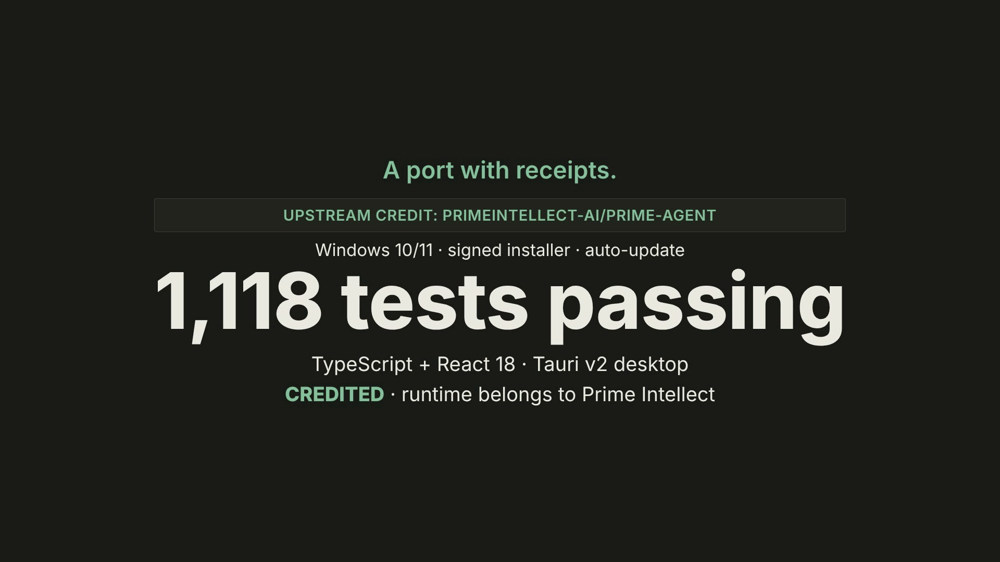
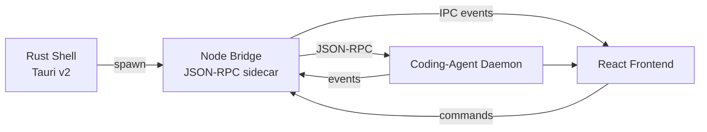

<div align="center">


# Sophos

**A graphical interface and enhanced interpretation of Prime Agent for Windows.**

Sophos brings [Prime Intellect’s](https://www.primeintellect.ai/)
open-source Prime Agent to Windows through a graphical desktop app.
Sophos adds a Tauri v2/Rust shell, React views for sessions and agents,
packaging, and reliability layers around the upstream runtime. Prime Intellect
created the agent runtime, daemon, and bridge;
Sophos pins their public v0.7.0 source and includes the upstream MIT notice.

**Windows-only.** Sophos is for Windows 10/11 developers who want
Prime Agent in a desktop app instead of a terminal. The GitLab Releases page
currently lists v0.6.0 as its latest tagged release; the signed updater feed
separately announces a v0.7.2 package. Those are different publication
records. See [Quick start](#quick-start--download--run) for both links and
the verification boundary.

[](https://v2.tauri.app/)
[](https://react.dev/)
[](https://www.typescriptlang.org/)
[](LICENSE)
[](https://gitlab.com/caylebalvarez-james/sophos/-/releases)

**Upstream credit:** [PrimeIntellect-ai/prime-agent](https://github.com/PrimeIntellect-ai/prime-agent) provides the agent runtime, daemon, and bridge. Sophos packages that MIT-licensed upstream; the desktop shell and UI are this project’s work.

</div>

> **⚠️ Beta Notice:** All Sophos versions before v1.0 are beta releases. Features may change, and there may be bugs. Use in production at your own risk.

---

## Launch video

[](brag-output/brag.mp4)

*20-second launch video rendered with `/brag` + Hyperframes — click the still to watch.*

## Screenshots

<table>
  <tr>
    <td width="50%"></td>
    <td width="50%"></td>
  </tr>
  <tr>
    <td width="50%"></td>
    <td width="50%"></td>
  </tr>
  <tr>
    <td width="50%"></td>
    <td width="50%"></td>
  </tr>
</table>

---

## Quick start — download & run

| Step | What |
|---|---|
| **1. Download** | Choose the latest tagged installer from [GitLab Releases](https://gitlab.com/caylebalvarez-james/sophos/-/releases) (currently v0.6.0), or the separate [v0.7.2 signed updater-feed package](https://gitlab.com/api/v4/projects/85429532/packages/generic/sophos/0.7.2/Sophos_0.7.2_x64-setup.exe). The feed package is not a tagged release and may not match this source tree. |
| **2. Install** | Run the `.exe`. The installer is configured for a per-user install; see the current Windows workflow for fresh-install verification status. |
| **3. Launch** | Open **Sophos**. The bundled Node runtime + daemon + bridge start automatically. |
| **4. Add a provider** | Go to **Settings → Providers** and add an LLM provider (API key or local model). |
| **5. Chat** | Start a new session and begin. |

> **Bundled runtime.** The Windows package is built to include the portable
> Node runtime, daemon, bridge, and shared `node_modules/`. The current
> candidate’s installer/UI acceptance is tracked separately from Linux checks.

---

## Verification status

**Implemented desktop and source checks.** Sophos
covers daemon-backed sessions and persisted transcripts across restart, saved
profiles whose instructions apply to new sessions, loopback local-model
discovery and catalog registration, and real daemon token-budget and semantic
compaction calls. Profile tool/skill/safety choices remain descriptive; they do
not grant permissions. The source passed 1,224 Vitest tests across 147 files,
82 Node tests, and eight Rust lease tests locally. The bridge boundary suite
passes nine checks, including concurrent credential updates and failed settings
writes. [PR #20 checks](https://github.com/cayleb-james2008/sophos/pull/20/checks)
record the hosted Windows results for the corresponding source head.
This does not establish current-source installer acceptance or live provider
inference. The CI and installer records below remain tied to their named
historical commits and packages.

The PR #16 source-publication baseline is
[`48d6cbdc011fcf762a872f1353f926419c994e29`](https://github.com/cayleb-james2008/sophos/commit/48d6cbdc011fcf762a872f1353f926419c994e29).
Its [Windows CI run](https://github.com/cayleb-james2008/sophos/actions/runs/37765204065)
passed 1,126 frontend tests, seven native containment regressions, staged and
standalone lifecycle checks (50/50 each), and eight CUA demo suites. Three
background keyboard subchecks remain skipped. These results do not establish
installation of the current-source MSI, live provider inference, or every
Windows version. The [live `master` branch](https://github.com/cayleb-james2008/sophos/tree/master)
may advance through reviewed documentation and test updates; the immutable PR #17
snapshot was `bea08f9d0c779cf990e125aabdda4ad5e6f58804`, and its exact-head
[CI run](https://github.com/cayleb-james2008/sophos/actions/runs/37858358710)
passed all three required jobs. The follow-up PR #18 corrected this baseline
label and fixed an asynchronous UI-test assertion; its exact-head push and PR
workflows passed all three jobs. Neither follow-up changed runtime behavior or
workflows. The differentiation document now describes the
[current source and its limits](docs/WHATS_DIFFERENT.md); the dated snapshots
below retain their original scope.

I keep local source checks separate from Windows installer and UI acceptance.
This acceptance snapshot covers PR #14's merged product/runtime candidate,
`ee1a5d80356dbf8039479e9594d130471b4031f6` (2026-10-08); the follow-up
standalone lifecycle developer-tool repair is separate and does not alter the
packaged runtime:

| Area | Result | Scope |
|---|---|---|
| Hosted unit + runtime regression suites | Pass | Exact merged-master Windows CI run `37737840508`: `npx vitest run` plus the workflow's explicit Node test lists; this is not a run of the root `npm test` script |
| `npm run build` | Pass | Exact merged-master Windows CI run; frontend and pinned runtime bundle built |
| Staged daemon/bridge E2E | Pass: 50/50 checks | Windows named pipes on hosted CI; real pinned Prime Agent v0.7.0 runtime. Recovery used one isolated loopback mock-provider request, not live inference |
| Guarded Windows MSI | Pass: build, notice, compatibility | Hosted workflow built the guarded MSI, checked the embedded MIT notice and pinned-daemon compatibility; candidate MSI was not installed |
| Signed updater-feed installer | Pass: 22 checks, 0 failures, 1 informational | Public v0.7.2 installer signature verified and tampering rejected; installed in a fresh profile. SHA-256: `04ee6d7e2bb7c0d6651c5e2de39fa01d9654602c4ddba8dd5777b92c06816584`. This feed package is not proven to contain this source revision. |
| Public-installer UI smoke | Pass: 7/7 | Fresh-profile smoke on the installed non-demo v0.7.2 binary; provider setup and inference were not invoked |
| Native Windows CUA | Pass: 8/8 suites, 0 failed | Hosted `windows-latest`, source-built release executable using the disclosed demo IPC path (no live provider inference); Smoke, Sessions, Agents, Chat, Inbox, Settings, Shell, and Studio. Three keyboard-delivery subchecks were skipped because background WebView2 does not reliably receive synthetic keyboard input; unit coverage remains. |
| Post-merge Windows CI | Pass | GitHub Actions run `37737840508` on exact merged commit `ee1a5d80356dbf8039479e9594d130471b4031f6`; both `test` and `cua-e2e` jobs passed. Exact PR #14 head push/PR runs `37733772986` and `37733777458` also passed. |
| Standalone lifecycle verifier | Pass in local follow-up; not part of this merged candidate | A separate staged-only repair resolved the compile-only `partial-json` dependency-layout failure; Linux standalone and full staged E2E each passed 50/50 on this source base. The repair is not yet part of this merge and local results do not establish hosted Windows lifecycle acceptance. |

The GitLab Releases page currently lists v0.6.0 as its latest tagged release,
while the separately signed updater feed announces a v0.7.2 package; these are
different publication records, and CI did not prove that the feed package
contains this source tree. The CI install/smoke evidence applies to the signed
updater-feed package, not to an installed candidate MSI or a new Sophos release.
Earlier PR #11 failures and the historical 47/50 CUA result on its old parent
were superseded by the exact-head and post-merge runs listed above. The stale
UIA identity after reconnect was fixed and the merged-master 50/50 recovery E2E
and native Agents CUA both passed.

The pinned Prime Agent production graph is staged by the same bundler for the
diagnostic and Windows release paths. A reviewed `basic-ftp@6.2.1` override
removes the FTP listing advisory while retaining `get-uri@6.0.5`,
`pac-proxy-agent@7.2.0`, and `proxy-agent@6.5.0`; a local FTP fixture verifies
the complete access/list/download path. The latest staged production audit
reports one high package record containing two unresolved `extract-zip`
symlink/path advisories (zero critical, no fix available). The Windows ZIP
helper auto-install path remains disabled, and no clean-audit claim is made.
Root development dependencies also retain audit findings. The staged standalone
lifecycle command's compile-only package-layout defect is addressed in a
separate, non-runtime tooling follow-up. Its direct standalone verification is
Linux-local; the Windows package/E2E evidence above does not substitute for a
hosted Windows invocation of that developer command.

### Reviewed follow-up publication

I merged the standalone lifecycle tooling repair in
[PR #15](https://github.com/cayleb-james2008/sophos/pull/15) after independent
review of `1e3af2cc23a90f94aa5c93089487fe0926a5dead` and successful exact-head
[push CI](https://github.com/cayleb-james2008/sophos/actions/runs/37746612479)
and [PR CI, attempt 2](https://github.com/cayleb-james2008/sophos/actions/runs/37746618605/attempts/2).
The merge is `46d990d20b8169b28dcd9b00a57096ca062b8966`. Both Windows
standalone invocations and both staged E2E runs passed 50/50 using one
loopback-provider request each. Windows IPC cancellation and Linux lifecycle
fixtures also passed. This supersedes the standalone-tooling limitation in
the historical snapshot above, not the public-package/source boundary.

PR CI's first attempt failed the Chat model-selector assertion, “MiniMax M3
not listed in model panel.” I retained that failure. Only the failed CUA job
was rerun at the unchanged head; it passed 8/8 suites, with the original
successful Windows test and Linux jobs reused. The three background keyboard
subcheck skips remain. The separate merged-head workflow is
[run 37756446836](https://github.com/cayleb-james2008/sophos/actions/runs/37756446836);
its terminal result must be checked before extending acceptance to that merge.

Independent review also found that the Rust shell ignored job-assignment
errors and substituted a null job when creation failed. The separate
containment candidate now refuses setup without a configured job and starts
daemon/sidecar processes suspended, assigns them, then resumes them. Failed
assignment or resume terminates and reaps the child before publishing its
pipes, with termination/reap errors surfaced if cleanup itself fails. Native
fault/descendant regressions are blocking Windows CI; this
source change is not acceptance evidence until those exact-head gates and
independent review pass. It is not an explanation of the historical shutdown
trace and is not included in PR #15's tooling-only approval.

The boundary is not an unconditional no-orphans guarantee: a hard kill between
suspended process creation and successful job assignment can leave a
suspended, non-executing process. Thread discovery also does not authenticate
against hostile same-user interference. The native tests cover assigned
children and their descendants, not atomic create-and-assign or those threats.

The first [PR #16 CI](https://github.com/cayleb-james2008/sophos/actions/runs/37757453312)
at `88f60b989073730c61422fecf79fb98d2c059e85` passed the native containment
step but failed a Linux lifecycle fixture: it printed readiness before
registering its SIGTERM handler. Independent delayed-start probes reproduced
the missing cleanup marker and passed after reversing that order. I repaired
the fixture handshake, not the production verifier, and retained the failed
job instead of waiving or retrying the unchanged candidate. The corrected
head requires fresh push and PR gates.

One further evidence limit: the public-smoke “no console errors” entry is an
explicit no-op placeholder, not console monitoring. Its reported 7/7 includes
that placeholder; only six entries perform real assertions. I do not infer a
clean WebView console from it. The five high production-audit records remain
unresolved; this containment/tooling work does not upgrade that dependency
graph or establish production, billing, or live-provider inference acceptance.

---

## What's inside

```
Sophos/
├── src-tauri/          # Rust shell — launches + supervises the daemon
├── src/                # React frontend (TypeScript + Vite + framer-motion)
│   ├── shell/          # SystemBar, Sidebar, app frame
│   ├── design/         # Token system, core primitives, motion
│   ├── features/       # Chat, Sessions, Agents, Inbox, Settings, Engine
│   └── views/          # Routed view wrappers
├── bridge/             # Node JSON-RPC sidecar (daemon ↔ frontend)
├── scripts/bundle.mjs  # Stages the runtime layout under resources/
├── resources/          # Bundled runtime: node/, daemon/, bridge/, node_modules/
└── verify/             # E2E harness (bundle + layout + daemon round-trip)
```

### Architecture



A Tauri v2 (Rust) shell spawns and supervises the Prime Agent coding-agent
daemon, fronts it with a Node bridge sidecar over JSON-RPC, and renders a
React frontend. The daemon does the actual AI work (tool calls, file edits,
shell commands); the bridge translates between the daemon's event stream and
the frontend's IPC; the frontend is the user-facing terminal-minimal UI.

---

## Design system

Sophos matches the [Prime Intellect](https://www.primeintellect.ai/) website
aesthetic — the visual language is derived directly from the live site:

| Token | Value | Role |
|---|---|---|
| Background | `#0e0e0e` | Near-black surfaces |
| Foreground | `#f4f4f4` | Off-white text (opacity-based hierarchy: 0.3 → 0.9) |
| Border | `#2a2a2a` | Hairline dividers — the primary visual separator |
| Accent | `#85ed75` | Terminal green — the sole color signal |
| Radius | `0px` | Sharp corners everywhere (circular dots excepted) |
| Display type | **Geist** | Vercel's type family |
| Mono type | **Geist Mono** | Terminal, code, commands |

**The Σ mark** — the Sophos icon is a sharp geometric **Σ** (sigma — the sum
of knowledge, nodding to the Greek root of "Sophos": wisdom/intellect).
Off-white `#f4f4f4` with a terminal-green `#85ed75` accent on a near-black
field. Flat, minimal, legible from 16px to 512px. Source: `public/sophos-icon.svg`.

---

## Code Mode — interface preview

Code Mode renders a typed SDK and a `run_code` program view, but the pinned
Prime Agent daemon does not execute Sophos `run_code` programs. The program,
tool-call cards, and demo responses are simulated previews, not native tool
execution. MCP server/resource/prompt, CUA/UIA, workspace-security, squad,
thought-tree, distilled-skill, workspace-twin, and checkpoint-restore bridge
operations are unsupported in this build and return an explicit error; their
related UI is preview-only.

## Profiles — saved instructions with preview-only controls

Custom profiles persist locally and can be selected for new sessions; Sophos
adds the selected profile's instructions to the daemon system prompt when the
session is created. Existing sessions keep their original setup. Tool, skill,
and safety choices in Profile Studio describe the profile and its UI preview;
they do not change daemon capabilities or enforce approval rules. Loopback
local-model discovery and catalog registration are supported, but a registered
model is not evidence of successful live inference.

---

## Build from source

### Prerequisites

| Tool | Why | Version |
|---|---|---|
| **Node.js** | build frontend + bridge | 22+ |
| **Rust** | compile the Tauri shell | 1.90+ |
| **Tauri CLI** | `npm run tauri` | 2.x |
| **Tauri Windows prerequisites** | build a native package | [Tauri v2 requirements](https://v2.tauri.app/start/prerequisites/) |
| **Git for Windows** | provides `bash` for the daemon | any recent |

### Build steps

```bash
# Start at the repository root. This command installs the frontend dependencies,
# clones the exact Prime Agent source pin into ignored .deps/ if needed, installs
# that source's locked dependencies with normal lifecycle scripts, compiles the
# upstream daemon + bridge, stages verified runtime inputs, and builds the UI.
npm ci
node scripts/bundle.mjs

# Run the real daemon/bridge offline protocol smoke test with isolated HOME.
# On Windows it uses the verified bundled node.exe; on Linux it uses the host
# Node executable and Unix-domain socket. Recovery uses an isolated loopback
# mock provider so the test does not make live model requests.
node verify/e2e.mjs

# Guarded Windows MSI build (requires Windows x64 + Rust/Tauri prerequisites).
node scripts/build-windows-installer.mjs
node scripts/verify-tauri-package.mjs
# The verifier extracts the MSI and checks the bundled upstream MIT notice.
```

The first `bundle.mjs` run needs network access to clone the pinned public
Prime Agent source, install locked npm dependencies, and obtain the hash-verified
official Node runtime. It does not call a model/provider API and needs no API
keys. Prime Agent publishes its source in a monorepo rather than publishing the
`@earendil-works/pi-*` package tarballs to npm; run the root bundler before
installing/building `bridge/` on its own. The bundle command also validates an
operator-supplied `PRIME_AGENT_REF` against the exact origin, tag commit, version,
MIT license, and clean-worktree state before using it.

The `bundle.mjs` manifest is written to `resources/.bundle-manifest.json` and records the native dependency build host, architecture, Windows target, build mode, and release eligibility. Default Windows release staging is accepted only on a real Windows x64 host. Linux/macOS may use `--diagnostic` for source/Unix-socket diagnostics; that provenance is permanently ineligible for the Windows installer, and `scripts/build-windows-installer.mjs` fails closed unless it validates a Windows-release manifest.

Flags: `--no-frontend`, `--no-bridge`, `--no-node-modules`, `--layout-check-only`, `--diagnostic`, `--help`.

The Windows CI workflow is configured to load ZeroMQ, Koffi, and the Windows clipboard addon using the bundled Windows Node binary, build the MSI through the guarded release entrypoint, then administratively extract the MSI and compare its `daemon/LICENSE` beside the installed `prime-agent-windows.exe` byte-for-byte with the staged upstream `resources/daemon/LICENSE`. These checks require a successful Windows runner; Linux results do not substitute for native or installer evidence.

### Environment variables

| Var | Purpose | Default |
|---|---|---|
| `PRIME_AGENT_REF` | optional Prime Agent source checkout | `.deps/prime-agent (pinned v0.7.0, MIT)` |
| `PRIME_NODE_RUNTIME` | verified `node.exe` override | official Node v24.18.0 win-x64 download (SHA-256 checked) |
| `PRIME_DAEMON_TCP` | Unsupported by pinned Prime Agent v0.7.0; Sophos does not set it | not set |
| `daemonTcp` (`settings.json`) | Legacy persisted field ignored by the Rust shell; it cannot enable TCP | ignored |

### Verify

```bash
node scripts/bundle.mjs
node verify/e2e.mjs          # staged bundle + real bridge/daemon JSON-RPC + recovery
```

Reports: `verify/e2e-report.json`, `verify/e2e-evidence.txt`.

---

## Layout of the bundled app

At runtime the Tauri resource dir contains (this is what
`src-tauri/src/settings.rs::resolve_runtime_paths()` expects):

```
<resource dir>/
  node/node-v24.18.0-win-x64/node.exe  # official runtime, SHA-256 pinned
  daemon/dist/cli.js            # coding-agent --mode daemon entry
  daemon/package.json
  daemon/LICENSE               # pinned upstream Prime Agent MIT notice
  bridge/dist/bridge/src/index.js  # JSON-RPC sidecar entry
  node_modules/                 # shared dependency tree
```

| Staging (`resources/`) | Runtime resource dir |
|---|---|
| `resources/daemon/dist` | `daemon/dist` |
| `resources/daemon/package.json` | `daemon/package.json` |
| `resources/daemon/LICENSE` | `daemon/LICENSE` |
| `resources/bridge/dist` | `bridge/dist` |
| `resources/node_modules` | `node_modules` |
| `resources/node/node-v24.18.0-win-x64` | `node` |

---

## TCP fallback compatibility blocker

The previously documented TCP fallback is not supported by the selected public
Prime Agent dependency. At commit `be9e2fa0714e7cd1c6bd9bdb1b554d2cc6550387`,
`DaemonSupervisor.listen()` calls Node's `net.Server.listen(this.socketPath)`
with no `tcp://` parsing or `PRIME_DAEMON_TCP` handling. Supplying
`--daemon-socket tcp://127.0.0.1:<port>` therefore does not create a TCP listener.
The Settings control is disabled and explicitly labels TCP unsupported; a legacy
`daemonTcp: true` value in `settings.json` is ignored by Rust. Both daemon and
bridge launch using the pinned runtime's supported default local socket.
The Linux verifier exercises the real daemon and bridge over a Unix-domain
socket; Windows named-pipe and native installer behavior require a Windows run.
Do not rely on TCP until a compatible upstream release or a reviewed transport
implementation is tested end-to-end.

---

## Troubleshooting

The guarded installer entrypoint builds an MSI only from a verified Windows-x64
release bundle and refuses Linux diagnostic provenance. Run
`node scripts/build-windows-installer.mjs`, then
`node scripts/verify-tauri-package.mjs` to inspect the package notice. A
successful MSI build and notice check do not prove installation; the GitHub
workflow separately installs the exact signed package announced by the public
updater feed and runs a fresh-profile app smoke. That public NSIS package is a
different artifact from the candidate MSI.

**Daemon: `DaemonSupervisorAlreadyRunningError`.**

A stale supervisor registry from a crashed daemon lives under
`~/.prime/agent/daemon-workers/`. Run `node <cli> daemon ps --cleanup` and
restart.

---

## License

MIT — same license as the upstream [PrimeIntellect-ai/prime-agent](https://github.com/PrimeIntellect-ai/prime-agent).

<div align="center">

*Brought to you by [Cayleb](https://gitlab.com/caylebalvarez-james). Built on the open superintelligence stack.*

</div>
